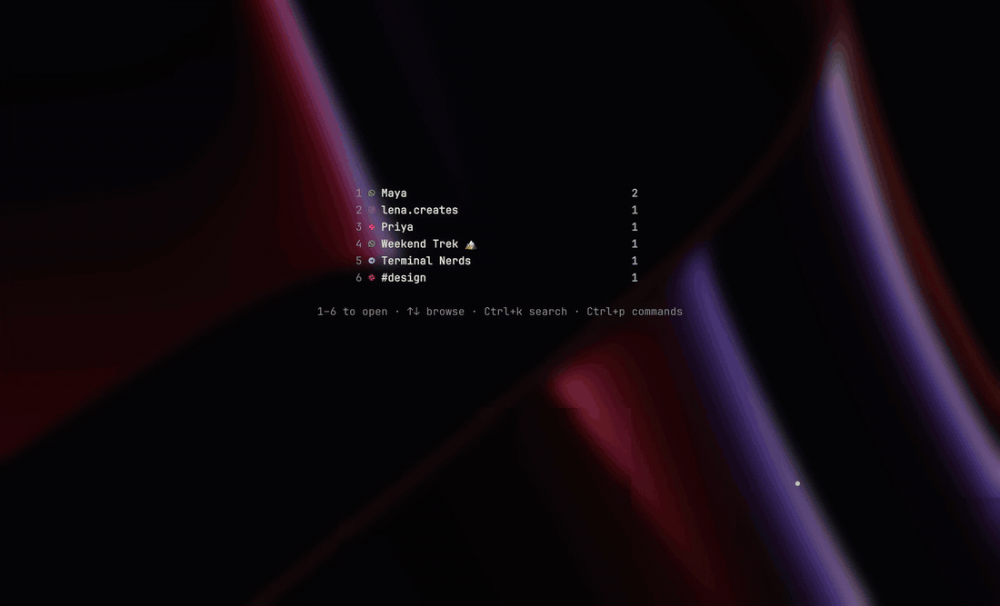
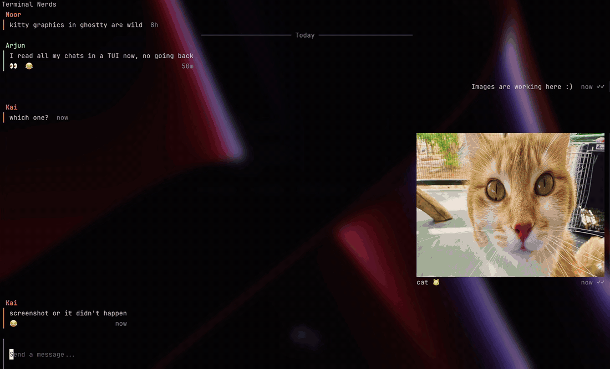
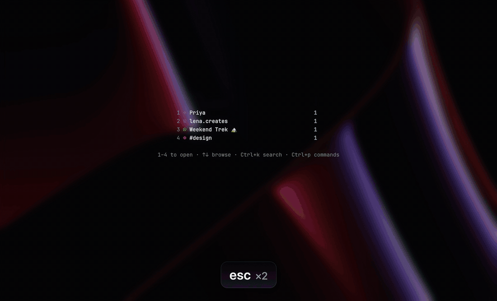

<p align="center">
  
</p>

<h1 align="center">tuimessenger</h1>

<p align="center">
Your chats from WhatsApp, Telegram, Slack and Instagram in one terminal app, with the bridges running on your own
machine.
</p>

https://github.com/user-attachments/assets/bb0a1f29-8515-4bcb-99df-c29424b06132

I live in the terminal and didn't want four apps (or someone's cloud) for my messages. tuimessenger is one program:
the network bridges, a small local server and a terminal client. Your chats, sessions and media stay in a folder on
your machine.

## Why it's different

- **No Matrix homeserver, no hosted service.** The usual way to get these networks into one client is a Matrix server
  plus four bridges plus a client. tuimessenger compiles the bridges in and talks to them directly.
- **One binary.** `tuimessenger tui` starts everything; `tuimessenger service install` keeps the bridges running in
  the background so you don't miss messages while the terminal client is closed.
- **Built for the keyboard:** jump to any chat with Ctrl+k, a command palette on Ctrl+p, a visual mode to reply,
  react and open media without the mouse, photos right in the terminal.
- **Scriptable:** `tuimessenger agent` gives scripts and AI agents your chats as JSON (see [AI agents](#ai-agents)).

## ⚠️ Read this first: your accounts

WhatsApp, Instagram, Telegram and Slack don't officially support third-party apps like this one. tuimessenger logs in
as a linked device / web session, the way the official desktop and web apps do, but a network **can flag, limit or
ban accounts it thinks use an unofficial client**. Meta (WhatsApp, Instagram) is the strictest. Many people use the same
bridges every day without trouble, but there's no guarantee: use it at your own risk, and consider trying it with an
account you can afford to lose first.

## Status

tuimessenger is young (v0.1). It's my daily driver on macOS.

- **macOS:** used every day.
- **Linux:** builds and runs (x86_64 and arm64), but has had far less real use. Reports welcome.
- **Not yet:** Signal (the most likely next network), running the backend on another machine such as a Raspberry Pi
  (the "Host backend" option in setup is a placeholder), per-network notification icons on fresh installs.
- **Telegram** needs your own free API keys (Telegram's rule for unofficial apps); the app walks you through it.

## Install

**Homebrew** (macOS and Linux):

```sh
brew install whyyor/tap/tuimessenger
```

**Download:** grab the archive for your system from [Releases](https://github.com/whyyor/tuimessenger/releases),
unpack it and put `tuimessenger` somewhere on your `PATH` (e.g. `~/.local/bin`). The binaries aren't signed by Apple,
so on macOS a browser download is blocked the first time; clear that once with
`xattr -d com.apple.quarantine ./tuimessenger` (Homebrew installs don't need this).

**Nix:**

```sh
nix run github:whyyor/tuimessenger -- tui          # try it
nix profile install github:whyyor/tuimessenger    # install it
```

**From source:** see [Building](#building).

Linux binaries need glibc 2.35 or newer (Ubuntu 22.04, Debian 12, Raspberry Pi OS and later). A
[Nerd Font](https://www.nerdfonts.com) in your terminal makes the icons show up; [yazi](https://yazi-rs.github.io)
is used as the file picker when it's installed.

## Quick start

1. **Start it:** `tuimessenger tui`, choose **Complete setup** (backend and client on this machine) and pick a
   password. The password protects the local server; other clients on this machine log in with it.
2. **Connect your networks:** Ctrl+p → **Networks** → pick one and follow the steps: a QR code or pairing code for
   WhatsApp, phone number and code for Telegram, a browser login for Slack and Instagram. The browser login opens
   Chrome, Chromium, Brave, Edge or Helium (`TUIMESSENGER_BROWSER` picks another) and closes it when you're done;
   without one, you paste the cookies instead. For Telegram, first create your keys: log in at
   [my.telegram.org](https://my.telegram.org) → API development tools → create an app (any name) → paste `api_id` and
   `api_hash` into the Networks panel.
3. **Chat:** Ctrl+k jumps to any chat, Enter sends, Ctrl+p shows every command and key.

Optional: `tuimessenger service install` runs the backend in the background (a launchd agent on macOS, a systemd user
unit on Linux), so your networks stay connected while the terminal client is closed. `tuimessenger service status`
shows how it's doing; `uninstall` removes it. After upgrading, run `service install` again to restart it.

## See it

| Jump to any chat with Ctrl+k, send photos with yazi | Reply and react |
|---|---|
|  |  |

| Photos open full screen, right in the terminal |
|---|
|  |

Everything in these recordings is made-up demo data (`tuimessenger demo serve`, a developer build); the photos are from
[Unsplash](https://unsplash.com/license) via [Lorem Picsum](https://picsum.photos).

## Keys

| Key | What it does |
|---|---|
| Ctrl+p | Command palette: every command, chat and key (`>` commands, `@` chats, `?` keys) |
| Ctrl+k | Jump to a chat (then Ctrl+p to peek without sending "seen") |
| ↑ ↓, 1–8 | Browse chats / open an unread chat (home screen) |
| Ctrl+; or Alt+v | Select messages (visual mode): j/k move, 1–6 quick react, + reactions, Space opens media, i message info |
| Ctrl+e | Emoji picker |
| Alt+u | Mark a chat unread |
| Shift+Enter | New line |
| Ctrl+c | Clear the input (Ctrl+z brings it back) |

## AI agents

`tuimessenger agent` gives scripts and AI agents your chats as JSON: `chats`, `messages`, `search` and `send`. Reading
works with the app closed, straight from the terminal client's data, and never marks anything as read. Sending needs a
login of the agent's own, which you create with `tuimessenger agent login` and can revoke with `agent logout`.
Nothing is sent without `-yes`, and the skill tells agents to show you the draft and wait for your OK first.

```sh
tuimessenger integration install claude opencode codex   # teach your agents how to use it
tuimessenger --skill                                     # or read the skill yourself
```

## Where things are

| | macOS | Linux |
|---|---|---|
| Data (chats, sessions, media, `config.yaml`) | `~/Library/Application Support/tuimessenger` | `~/.local/share/tuimessenger` |
| Logs | `~/Library/Logs/tuimessenger` | `~/.local/state/tuimessenger` |

- `tui/config/terminal.yaml` in the data folder holds the client's preferences (changed from the TUI too);
  `tui/config/tuimessenger.yaml` holds your colours and pinned preferences and wins over it. Keep it in your
  dotfiles and link it here.
- `tui/client.db` is the client's copy of your chats.
- Logs: `tuimessenger.log` (backend), `terminal.log` and `client.log` (client), and `crash.log`, which keeps the
  stack trace if the app ever crashes. Please attach it to bug reports.
- macOS notifications come from `~/.local/opt/tuimessenger/notifiers/tuimessenger.app`, which tuimessenger sets up
  itself (optional per-network icons: `<Network>.app` next to it).

## Building

Go 1.26+ and a C compiler (cgo, for SQLite). Always build with the `goolm` and `sqlite_fts5` tags (the Makefile does
this):

```sh
make build   # or: go build -tags goolm,sqlite_fts5 ./cmd/tuimessenger
make test
make vet
```

Without `goolm`, the build looks for the libolm C library (`olm/olm.h not found`).

Releases: a `vX.Y.Z` tag on `main` builds the binaries for macOS and Linux, publishes the GitHub release and updates
the Homebrew formula (`.github/workflows/release.yml`).

## Branches

- `dev` is staging: every pull request targets `dev`, and it's what gets tested day to day.
- `main` only gets releases: `dev` is merged into it and tagged (`v0.1.0`), and downloads are built from the tags.
- Urgent fixes branch off `main`, go to `main`, and `main` is merged back into `dev`.

## Contributing: keep personal data out

CI runs gitleaks (`.gitleaks.toml`) on every commit for secrets and personal data: phone numbers, chat-network user
IDs, home-folder paths. Use made-up values in tests (`+15550100001`, `@whatsapp_15550100001`, "Mariana"). Locally,
enable the hooks once with `git config core.hooksPath .githooks`; they also check against a private word list in
`.git/info/sensitive-words` (one per line; never committed or pushed) for names and numbers only you know.

## How this was made

I built tuimessenger with a lot of help from AI coding assistants, the same way I'd use any other tool. The decisions
are mine: running the bridges locally without a Matrix server, the setup modes, the design, what to leave out. I review
every change before it's merged, and I use it every day.

## Credits

tuimessenger is built on the work of others:

- **The terminal client** (`internal/tui`, `internal/rpc`, `internal/hicli`, `internal/rainbow`) comes from
  [gomuks](https://github.com/gomuks/gomuks) by Tulir Asokan and contributors, via the fork
  [whyyor/gomuks](https://github.com/whyyor/gomuks), and was imported with its git history.
- **The network bridges** are the [mautrix](https://github.com/mautrix) bridges (WhatsApp, Telegram, Meta, Slack)
  and the [mautrix-go](https://github.com/mautrix/go) bridge library.
- **Notifications on macOS** are shown by [terminal-notifier](https://github.com/julienXX/terminal-notifier) by
  Eloy Durán and Julien Blanchard (MIT), bundled with tuimessenger's name and icon; see `THIRD_PARTY_NOTICES.md`.

## License

tuimessenger is licensed under the GNU Affero General Public License v3 (see `LICENSE`). Imported files keep their
original license headers: parts of the client are under the Mozilla Public License 2.0 (`internal/hicli/LICENSE`).
